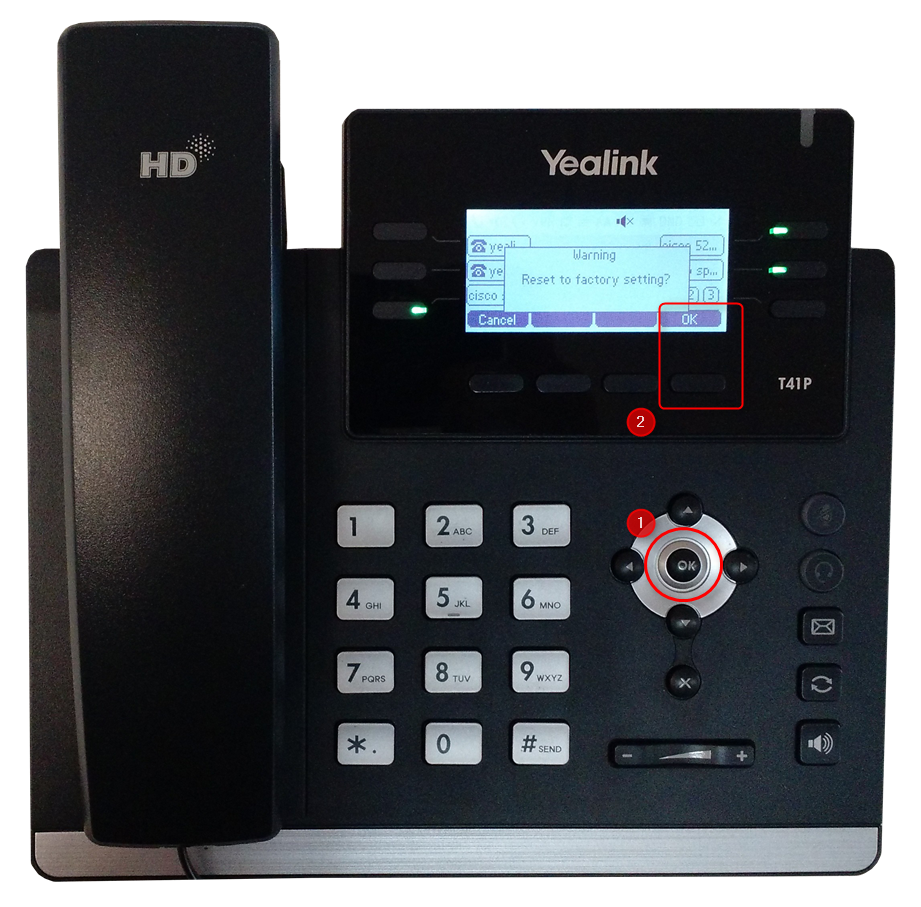

# Reset Factory

### Prerequisites

* A powered-on Yealink IP phone.
* Admin credentials (default: username "admin", password "admin") for web reset.
* Access to the phone’s web interface via its IP address for web reset.
* Physical access to the phone for button reset.

### Steps

#### Method 1: Reset via Web Interface

1. **Access the Web Interface**:
   * Refer to Login to access the IP Phone web interface using its IP address.
2. **Navigate to Reset Settings**:
   * Go to the "Settings" tab, click "Upgrade," and look for a "Reset to Factory" or "Reset" option.
3.  **Initiate Factory Reset**:

    * Select "Reset to Factory Settings" and confirm the action when prompted.
    * The phone will reboot and restore default settings (e.g., username "admin," password "admin").

    <figure><figcaption></figcaption></figure>
4. **Reconfigure the Phone**:
   * After the reset, reconfigure network and account settings (see [Configure Settings](configure-settings.md)).

#### Method 2: Reset via Physical Button

1. **Locate the OK Button**:
   * On the Yealink IP phone, find the "OK" button (typically the navigation button).
2. **Initiate Factory Reset**:
   * Press and hold the "OK" button for approximately 5-10 seconds until a reset confirmation message appears on the display (e.g., "Reset to Factory Settings?").
3.  **Confirm Reset**:

    * Use the navigation keys to select "Yes" or press "OK" again to confirm.
    * The phone will reboot and restore default settings.

    
<figure><figcaption></figcaption></figure>

4. **Reconfigure the Phone**:
   * After the reset, reconfigure network and account settings (see [Configure Settings](configure-settings.md)).


A factory reset erases all custom settings, including SIP server details and hotdesking configurations. Document your settings before resetting.

