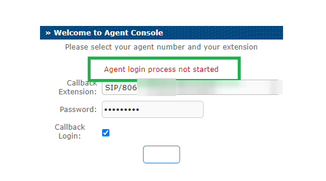

# Agent login process not started

### Prerequisites

* Logged into PBX admin (see[ Logging into PBX Admin)](../logging-into-pbx-admin.md).
* A web browser (e.g., Chrome, Firefox).
* The user’s extension number (e.g., "SIP/806 - Jane Doe").
* Contact information for the user’s team leader to confirm the correct queue.

### Steps

1.  **Identify the Error**:

    * When attempting to log into the Agent Console ("Call Center" > "Agent Console"), note the error message "<mark style="color:red;">Agent login process not started</mark>" after entering the extension (e.g., "SIP/806 - Jane Doe") and password.

    
<figure><figcaption></figcaption></figure>

2. **Understand the Cause**:
   * This error indicates that the user’s extension does not belong to any queue in the PBX system.
3. **Consult the Team Leader**:
   * Contact the user’s team leader to determine the correct queue the user should be assigned to (e.g., a support or sales queue).
4. **Add the User to the Correct Queue**:
   * Log in to the PBX web interface (`172.20.31.10`).
   * Navigate to "PBX" > "PBX Configuration" > "Queues."
   * Select the appropriate queue (e.g., "600-Support") as confirmed by the team leader.
   * In the "Dynamic Agents" field, add the user’s extension with the rank/priority (e.g., "S806,1").
   * Click "Submit Changes" and then "Apply Config" to save the changes.
5. **Verify Queue Assignment**:
   * Return to the "Queues" section and confirm the extension (e.g., "806") is listed under the selected queue.
6. **Test the Login Again**:
   * Go back to "Call Center" > "Agent Console."
   * Select the extension (e.g., "SIP/806 - Jane Doe"), enter the password, and click "Enter."
   * Ensure the login succeeds and the Agent Console loads (see [Login to Queue](../how-to-guides/login-to-queue.md)).


If the error persists after adding the extension to a queue, verify the extension’s registration status (see [Get Status or IP Address of Extension](../how-to-guides/get-status-and-ip-address-of-extension.md)).

