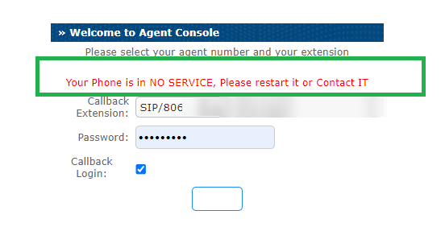

# Your Phone is NO SERVICE

### Prerequisites

* Access to the user’s MicroSIP softphone or Yealink IP Phone.
* Admin or user credentials for the PBX web interface (`http://172.20.31.10/`) if needed.
* A web browser (e.g., Chrome, Firefox).
* The user’s extension details (e.g., "SIP/806 - Jane Doe") and password.

### Steps

1.  **Identify the Error**:

    * When attempting to log into the Agent Console ("Call Center" > "Agent Console"), note the error message <mark style="color:red;">"Your Phone is in NO SERVICE. Please restart it or Contact IT"</mark> after entering the extension (e.g., "SIP/806 - Jane Doe") and password.

    
<figure><figcaption></figcaption></figure>

2. **Understand the Cause**:
   * This error indicates that the user’s phone or MicroSIP is not registered or functioning correctly with the system.
3. **Verify Login Credentials**:
   * Open the MicroSIP softphone or Yealink IP Phone interface.
   * Ensure the user is logged in with the correct extension (e.g., "806") and password.
   * If credentials are incorrect, update them to match the PBX extension settings ("PBX" > "PBX Configurations" > "Extensions").
4. **Test Phone Functionality**:
   * Make a test call from the phone or MicroSIP to confirm it can connect and complete calls.
   * If the call fails, restart the device and retry.
5. **Restart the Phone or MicroSIP**:
   * Restart the Yealink IP Phone by unplugging it and plugging it back in, or restart MicroSIP by closing and reopening the application.
   * Wait for the device to reconnect to the network and register with the system.
6. **Verify Registration Status**:
   * Log in to the PBX web interface and navigate to "PBX" > "PBX Configuration" > "Tools" > "Asterisk-CLI."
   * Run the command `sip show peers` and check that the extension (e.g., "806") shows a status of "OK" (see [Get Status or IP Address of Extension](../how-to-guides/get-status-and-ip-address-of-extension.md)).
7. **Test the Login Again**:
   * Return to "Call Center" > "Agent Console."
   * Select the extension (e.g., "SIP/806 - Jane Doe"), enter the password, and click "Enter."
   * Ensure the login succeeds and the Agent Console loads (see [Login to Queue](../how-to-guides/login-to-queue.md)).
8. **Contact IT if Unresolved**:
   * If the issue persists after restarting and verifying, contact the IT teamleader for further assistance, providing the extension number and error details.


Check network connectivity. Ensure the phone’s firmware is up to date and the SIP server settings match the PBX configuration.

